### Escuela Colombiana de Ingeniería
### Arquitecturas de Software - ARSW
### Nombres : Andres Sabogal - Marco Alvarez
## Escalamiento en Azure con Maquinas Virtuales, Sacale Sets y Service Plans

### Dependencias
* Cree una cuenta gratuita dentro de Azure. Para hacerlo puede guiarse de esta [documentación](https://azure.microsoft.com/es-es/free/students/). Al hacerlo usted contará con $100 USD para gastar durante 12 meses.

### Parte 0 - Entendiendo el escenario de calidad

Adjunto a este laboratorio usted podrá encontrar una aplicación totalmente desarrollada que tiene como objetivo calcular el enésimo valor de la secuencia de Fibonnaci.

**Escalabilidad**
Cuando un conjunto de usuarios consulta un enésimo número (superior a 1000000) de la secuencia de Fibonacci de forma concurrente y el sistema se encuentra bajo condiciones normales de operación, todas las peticiones deben ser respondidas y el consumo de CPU del sistema no puede superar el 70%.

### Parte 1 - Escalabilidad vertical

1. Diríjase a el [Portal de Azure](https://portal.azure.com/) y a continuación cree una maquina virtual con las características básicas descritas en la imágen 1 y que corresponden a las siguientes:
    * Resource Group = SCALABILITY_LAB
    * Virtual machine name = VERTICAL-SCALABILITY
    * Image = Ubuntu Server 
    * Size = Standard B1ls
    * Username = scalability_lab
    * SSH publi key = Su llave ssh publica


2. Para conectarse a la VM use el siguiente comando, donde las `x` las debe remplazar por la IP de su propia VM (Revise la sección "Connect" de la virtual machine creada para tener una guía más detallada).

    `ssh scalability_lab@xxx.xxx.xxx.xxx`

3. Instale node, para ello siga la sección *Installing Node.js and npm using NVM* que encontrará en este [enlace](https://linuxize.com/post/how-to-install-node-js-on-ubuntu-18.04/).
4. Para instalar la aplicación adjunta al Laboratorio, suba la carpeta `FibonacciApp` a un repositorio al cual tenga acceso y ejecute estos comandos dentro de la VM:

    `git clone <your_repo>`

    `cd <your_repo>/FibonacciApp`

    `npm install`

5. Para ejecutar la aplicación puede usar el comando `npm FibinacciApp.js`, sin embargo una vez pierda la conexión ssh la aplicación dejará de funcionar. Para evitar ese compartamiento usaremos *forever*. Ejecute los siguientes comando dentro de la VM.

    ` node FibonacciApp.js`

6. Antes de verificar si el endpoint funciona, en Azure vaya a la sección de *Networking* y cree una *Inbound port rule* tal como se muestra en la imágen. Para verificar que la aplicación funciona, use un browser y user el endpoint `http://xxx.xxx.xxx.xxx:3000/fibonacci/6`. La respuesta debe ser `The answer is 8`.


7. La función que calcula en enésimo número de la secuencia de Fibonacci está muy mal construido y consume bastante CPU para obtener la respuesta. Usando la consola del Browser documente los tiempos de respuesta para dicho endpoint usando los siguintes valores:
    * 1000000
    * 1010000
    * 1020000
    * 1030000
    * 1040000
    * 1050000
    * 1060000
    * 1070000
    * 1080000
    * 1090000    

8. Dírijase ahora a Azure y verifique el consumo de CPU para la VM. (Los resultados pueden tardar 5 minutos en aparecer).


9. Ahora usaremos Postman para simular una carga concurrente a nuestro sistema. Siga estos pasos.
    * Instale newman con el comando `npm install newman -g`. Para conocer más de Newman consulte el siguiente [enlace](https://learning.getpostman.com/docs/postman/collection-runs/command-line-integration-with-newman/).
    * Diríjase hasta la ruta `FibonacciApp/postman` en una maquina diferente a la VM.
    * Para el archivo `[ARSW_LOAD-BALANCING_AZURE].postman_environment.json` cambie el valor del parámetro `VM1` para que coincida con la IP de su VM.
    * Ejecute el siguiente comando.

    ```
    newman run ARSW_LOAD-BALANCING_AZURE.postman_collection.json -e [ARSW_LOAD-BALANCING_AZURE].postman_environment.json -n 10 &
    newman run ARSW_LOAD-BALANCING_AZURE.postman_collection.json -e [ARSW_LOAD-BALANCING_AZURE].postman_environment.json -n 10
    ```

10. La cantidad de CPU consumida es bastante grande y un conjunto considerable de peticiones concurrentes pueden hacer fallar nuestro servicio. Para solucionarlo usaremos una estrategia de Escalamiento Vertical. En Azure diríjase a la sección *size* y a continuación seleccione el tamaño `B2ms`.


11. Una vez el cambio se vea reflejado, repita el paso 7, 8 y 9.
12. Evalue el escenario de calidad asociado al requerimiento no funcional de escalabilidad y concluya si usando este modelo de escalabilidad logramos cumplirlo.
13. Vuelva a dejar la VM en el tamaño inicial para evitar cobros adicionales.

**Preguntas**

1. ¿Cuántos y cuáles recursos crea Azure junto con la VM?
2. ¿Brevemente describa para qué sirve cada recurso?
3. ¿Al cerrar la conexión ssh con la VM, por qué se cae la aplicación que ejecutamos con el comando `npm FibonacciApp.js`? ¿Por qué debemos crear un *Inbound port rule* antes de acceder al servicio?
4. Adjunte tabla de tiempos e interprete por qué la función tarda tando tiempo.
5. Adjunte imágen del consumo de CPU de la VM e interprete por qué la función consume esa cantidad de CPU.
6. Adjunte la imagen del resumen de la ejecución de Postman. Interprete:
    * Tiempos de ejecución de cada petición.
    * Si hubo fallos documentelos y explique.
7. ¿Cuál es la diferencia entre los tamaños `B2ms` y `B1ls` (no solo busque especificaciones de infraestructura)?
8. ¿Aumentar el tamaño de la VM es una buena solución en este escenario?, ¿Qué pasa con la FibonacciApp cuando cambiamos el tamaño de la VM?
9. ¿Qué pasa con la infraestructura cuando cambia el tamaño de la VM? ¿Qué efectos negativos implica?
10. ¿Hubo mejora en el consumo de CPU o en los tiempos de respuesta? Si/No ¿Por qué?
11. Aumente la cantidad de ejecuciones paralelas del comando de postman a `4`. ¿El comportamiento del sistema es porcentualmente mejor?

### Parte 2 - Escalabilidad horizontal

#### Crear el Balanceador de Carga

Antes de continuar puede eliminar el grupo de recursos anterior para evitar gastos adicionales y realizar la actividad en un grupo de recursos totalmente limpio.

1. El Balanceador de Carga es un recurso fundamental para habilitar la escalabilidad horizontal de nuestro sistema, por eso en este paso cree un balanceador de carga dentro de Azure tal cual como se muestra en la imágen adjunta.


2. A continuación cree un *Backend Pool*, guiese con la siguiente imágen.


3. A continuación cree un *Health Probe*, guiese con la siguiente imágen.


4. A continuación cree un *Load Balancing Rule*, guiese con la siguiente imágen.


5. Cree una *Virtual Network* dentro del grupo de recursos, guiese con la siguiente imágen.


#### Crear las maquinas virtuales (Nodos)

Ahora vamos a crear 3 VMs (VM1, VM2 y VM3) con direcciones IP públicas standar en 3 diferentes zonas de disponibilidad. Después las agregaremos al balanceador de carga.

1. En la configuración básica de la VM guíese por la siguiente imágen. Es importante que se fije en la "Avaiability Zone", donde la VM1 será 1, la VM2 será 2 y la VM3 será 3.


2. En la configuración de networking, verifique que se ha seleccionado la *Virtual Network*  y la *Subnet* creadas anteriormente. Adicionalmente asigne una IP pública y no olvide habilitar la redundancia de zona.


3. Para el Network Security Group seleccione "avanzado" y realice la siguiente configuración. No olvide crear un *Inbound Rule*, en el cual habilite el tráfico por el puerto 3000. Cuando cree la VM2 y la VM3, no necesita volver a crear el *Network Security Group*, sino que puede seleccionar el anteriormente creado.


4. Ahora asignaremos esta VM a nuestro balanceador de carga, para ello siga la configuración de la siguiente imágen.


5. Finalmente debemos instalar la aplicación de Fibonacci en la VM. para ello puede ejecutar el conjunto de los siguientes comandos, cambiando el nombre de la VM por el correcto

```
git clone https://github.com/daprieto1/ARSW_LOAD-BALANCING_AZURE.git

curl -o- https://raw.githubusercontent.com/creationix/nvm/v0.34.0/install.sh | bash
source /home/vm1/.bashrc
nvm install node

cd ARSW_LOAD-BALANCING_AZURE/FibonacciApp
npm install

npm install forever -g
forever start FibonacciApp.js
```

Realice este proceso para las 3 VMs, por ahora lo haremos a mano una por una, sin embargo es importante que usted sepa que existen herramientas para aumatizar este proceso, entre ellas encontramos Azure Resource Manager, OsDisk Images, Terraform con Vagrant y Paker, Puppet, Ansible entre otras.

#### Probar el resultado final de nuestra infraestructura

1. Porsupuesto el endpoint de acceso a nuestro sistema será la IP pública del balanceador de carga, primero verifiquemos que los servicios básicos están funcionando, consuma los siguientes recursos:

```
http://52.155.223.248/
http://52.155.223.248/fibonacci/1
```

2. Realice las pruebas de carga con `newman` que se realizaron en la parte 1 y haga un informe comparativo donde contraste: tiempos de respuesta, cantidad de peticiones respondidas con éxito, costos de las 2 infraestrucruras, es decir, la que desarrollamos con balanceo de carga horizontal y la que se hizo con una maquina virtual escalada.

3. Agregue una 4 maquina virtual y realice las pruebas de newman, pero esta vez no lance 2 peticiones en paralelo, sino que incrementelo a 4. Haga un informe donde presente el comportamiento de la CPU de las 4 VM y explique porque la tasa de éxito de las peticiones aumento con este estilo de escalabilidad.

```
newman run ARSW_LOAD-BALANCING_AZURE.postman_collection.json -e [ARSW_LOAD-BALANCING_AZURE].postman_environment.json -n 10 &
newman run ARSW_LOAD-BALANCING_AZURE.postman_collection.json -e [ARSW_LOAD-BALANCING_AZURE].postman_environment.json -n 10 &
newman run ARSW_LOAD-BALANCING_AZURE.postman_collection.json -e [ARSW_LOAD-BALANCING_AZURE].postman_environment.json -n 10 &
newman run ARSW_LOAD-BALANCING_AZURE.postman_collection.json -e [ARSW_LOAD-BALANCING_AZURE].postman_environment.json -n 10
```

**Preguntas**

* ¿Cuáles son los tipos de balanceadores de carga en Azure y en qué se diferencian?, ¿Qué es SKU, qué tipos hay y en qué se diferencian?, ¿Por qué el balanceador de carga necesita una IP pública?
* ¿Cuál es el propósito del *Backend Pool*?
* ¿Cuál es el propósito del *Health Probe*?
* ¿Cuál es el propósito de la *Load Balancing Rule*? ¿Qué tipos de sesión persistente existen, por qué esto es importante y cómo puede afectar la escalabilidad del sistema?.
* ¿Qué es una *Virtual Network*? ¿Qué es una *Subnet*? ¿Para qué sirven los *address space* y *address range*?
* ¿Qué son las *Availability Zone* y por qué seleccionamos 3 diferentes zonas?. ¿Qué significa que una IP sea *zone-redundant*?
* ¿Cuál es el propósito del *Network Security Group*?
* Informe de newman 1 (Punto 2)
* Presente el Diagrama de Despliegue de la solución.

---

# Desarrollo del laboratorio

**Autor:** Andrés Sabogal

Toda la infraestructura se creó con **Azure CLI desde Azure Cloud Shell** (scripts en [`scripts/`](scripts/)). Los datos crudos de cada medición están en [`results/`](results/) y las capturas y gráficas en [`images/solution/`](images/solution/). Las cargas con newman se lanzaron desde Cloud Shell, es decir, desde una máquina distinta a las VMs.

## Ajustes por restricciones de la suscripción (Azure for Students)

La suscripción no permite reproducir literalmente los tamaños del enunciado:

* Solo se puede desplegar en 5 regiones (`eastus2`, `brazilsouth`, `mexicocentral`, `canadacentral`, `southcentralus`), y en **todas** `Standard_B1ls` y `Standard_B2ms` aparecen como `NotAvailableForSubscription` (al intentarlo, `az vm create` responde `SkuNotAvailable`).
* La cuota regional es de **6 vCPU** en total, y ningún tamaño de 1 vCPU tiene cuota asignada.

Por eso se usó **Brazil South** (única región con tamaños disponibles en las zonas 1, 2 y 3) y se mantuvo la idea del laboratorio (escalar verticalmente = duplicar la CPU de una sola máquina):

| Enunciado | Usado | vCPU | RAM |
|---|---|---|---|
| `B1ls` | `Standard_D2s_v4` | 2 | 8 GiB |
| `B2ms` | `Standard_D4s_v4` | 4 | 16 GiB |
| 3 VMs (Parte 2) | `D2s_v4` (zonas 1 y 2) + `D2_v4` (zona 3) | 2 c/u | 8 GiB c/u |
| 4ª VM (Parte 2) | **No cabe en la cuota de 6 vCPU** (ver Parte 2, punto 3) | | |

`D2_v4` y `D2s_v4` tienen el mismo procesador y la misma capacidad de cómputo (la "s" solo indica soporte de disco Premium); se usó `D2_v4` para la VM3 porque la cuota de la familia DSv4 es de 4 vCPU.

## Parte 1 - Escalabilidad vertical

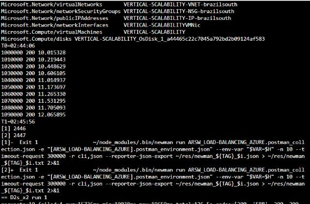

### 1. ¿Cuántos y cuáles recursos crea Azure junto con la VM?

Además de la VM, Azure creó **5 recursos** asociados (6 en total, salida de `az resource list`):

| # | Tipo | Nombre |
|---|---|---|
| 1 | `Microsoft.Compute/virtualMachines` | `VERTICAL-SCALABILITY` |
| 2 | `Microsoft.Compute/disks` (OS disk) | `VERTICAL-SCALABILITY_OsDisk_1_...` |
| 3 | `Microsoft.Network/networkInterfaces` | `VERTICAL-SCALABILITYVMNic` |
| 4 | `Microsoft.Network/publicIPAddresses` | `VERTICAL-SCALABILITY-IP-brazilsouth` |
| 5 | `Microsoft.Network/networkSecurityGroups` | `VERTICAL-SCALABILITY-NSG-brazilsouth` |
| 6 | `Microsoft.Network/virtualNetworks` (con su subnet) | `VERTICAL-SCALABILITY-VNET-brazilsouth` |

Si la VM se crea desde el portal y se genera la llave allí, aparece además un recurso **SSH key**.

### 2. ¿Para qué sirve cada recurso?

* **Virtual Machine:** el cómputo (vCPU + RAM) donde corre Ubuntu y la FibonacciApp.
* **OS Disk:** disco administrado persistente con el sistema operativo y los archivos; sobrevive a reinicios y cambios de tamaño.
* **NIC:** conecta la VM a la subnet; tiene la IP privada y referencia a la IP pública y al NSG.
* **Public IP:** dirección accesible desde Internet para entrar por SSH y consumir el servicio en el puerto 3000.
* **NSG:** firewall de capa 4 con reglas de entrada/salida por puerto, protocolo e IP (por defecto solo deja entrar SSH 22).
* **Virtual Network / Subnet:** red privada aislada donde vive la VM; define el rango de IPs privadas.
* **SSH key (portal):** guarda la llave pública usada para autenticarse sin contraseña.

### 3. ¿Por qué se cae la app al cerrar SSH? ¿Por qué crear un Inbound port rule?

* El proceso `node FibonacciApp.js` es **hijo de la sesión de shell**. Al cerrar SSH la terminal envía **SIGHUP** a sus procesos hijos y estos terminan. Por eso se usa un gestor como `forever` (o `pm2`, `nohup`, `systemd`) que desacopla el proceso de la terminal y lo reinicia si falla. En este lab además se registró `forever` en `crontab @reboot` para que la app vuelva sola después de un reinicio.
* El **NSG bloquea por defecto todo el tráfico entrante** desde Internet excepto el que se habilita explícitamente (SSH 22). La app escucha en el puerto 3000, así que sin la regla de entrada para 3000 las peticiones nunca llegan a la VM.

### 4. Tabla de tiempos e interpretación

Medido con `curl` (tiempo total de la petición) desde Cloud Shell:

| n | D2s_v4 (s) | D4s_v4 (s) |
|---|---|---|
| 1.000.000 | 10,02 | 8,91 |
| 1.010.000 | 10,22 | 10,25 |
| 1.020.000 | 10,45 | 9,22 |
| 1.030.000 | 10,61 | 9,39 |
| 1.040.000 | 11,01 | 9,56 |
| 1.050.000 | 11,17 | 9,70 |
| 1.060.000 | 11,27 | 9,96 |
| 1.070.000 | 11,53 | 11,04 |
| 1.080.000 | 11,71 | 10,51 |
| 1.090.000 | 12,07 | 10,45 |
| **Promedio** | **11,00** | **9,90** |

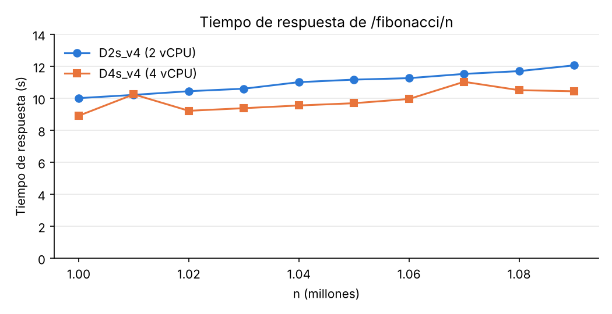

**¿Por qué tarda tanto?** El algoritmo es iterativo O(n) en número de sumas, pero los números de Fibonacci crecen ~0,694·n bits: F(1.000.000) tiene **~208.988 dígitos**. Cada suma con `big-integer` cuesta O(número de dígitos), así que el costo real es **O(n²)**: por eso el tiempo sube con n (+20% de 1,00 M a 1,09 M). Además, en cada iteración se crea un BigInteger nuevo (mucha asignación de memoria y trabajo del Garbage Collector) y se hace sobre un solo hilo.

### 5. Consumo de CPU e interpretación

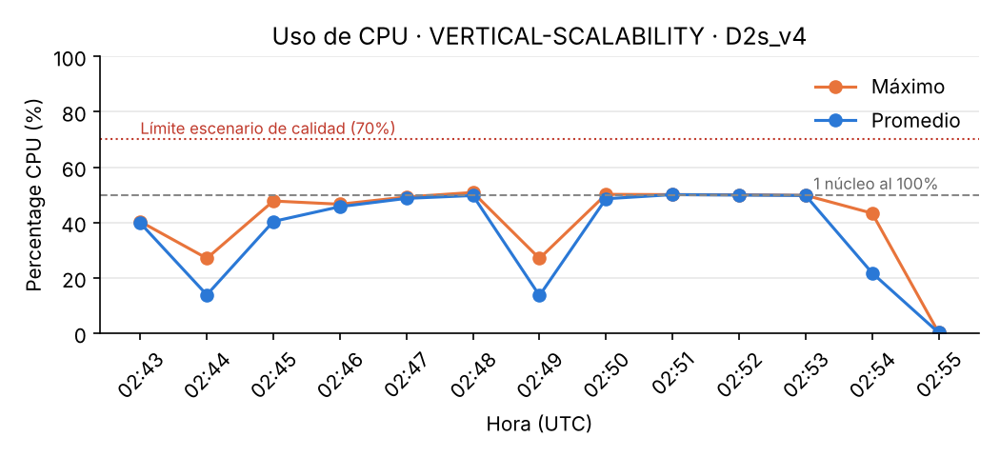

Durante las pruebas la CPU de la D2s_v4 se mantuvo en **~50%** (máximo 50,85%). Ese 50% es exactamente **un núcleo de dos al 100%**: el cálculo es **CPU-bound puro** (no hay I/O ni esperas) y Node.js ejecuta el código JavaScript en **un solo hilo**, así que nunca puede usar más de un núcleo. Las caídas a ~14% corresponden a los cambios entre pruebas.

### 6. Resumen de newman (2 ejecuciones paralelas, D2s_v4)

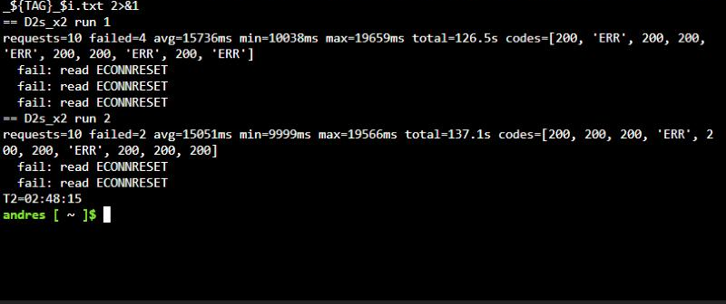

| Ejecución | Peticiones | Fallidas | Promedio | Mín | Máx | Duración |
|---|---|---|---|---|---|---|
| 1 | 10 | 4 | 15,7 s | 10,0 s | 19,7 s | 126,5 s |
| 2 | 10 | 2 | 15,1 s | 10,0 s | 19,6 s | 137,1 s |
| **Total** | **20** | **6 (30%)** | **15,4 s** | | | |

* **Tiempos:** una petición sola tarda ~10 s, pero con 2 clientes concurrentes el promedio sube a ~15 s y el máximo a ~20 s. Como Node atiende una petición a la vez, cada petición tiene que **esperar a que termine la del otro cliente** (el tiempo se suma, no se paraleliza).
* **Fallos:** 6 de 20 peticiones fallaron con `read ECONNRESET`, es decir, el servidor cerró la conexión TCP en vez de responder. La explicación más probable: los clientes reutilizan la conexión (keep-alive) y, mientras el único hilo de Node está bloqueado calculando la petición del otro cliente, el servidor no alcanza a gestionar a tiempo los timeouts de las conexiones ociosas (el *keep-alive timeout* de Node es de 5 s por defecto). La conexión se cierra justo cuando el cliente envía por ella su siguiente petición. Es consecuencia directa de que el event loop esté bloqueado por un cálculo largo: ningún fallo ocurrió cuando cada cliente tuvo su propio nodo (Parte 2).

### 7. Diferencia entre `B2ms` y `B1ls`

| | B1ls | B2ms |
|---|---|---|
| vCPU | 1 | 2 |
| RAM | 0,5 GiB | 8 GiB |
| Rendimiento base de CPU | 5% | 60% (de 200%) |
| Créditos de CPU ganados/hora | 3 | 36 |
| Discos de datos máx. | 2 | 4 |
| Costo aprox. (Linux, East US) | ~USD 3,8/mes | ~USD 60/mes |

Más allá del hardware: ambos son **burstable** (serie B). La VM acumula créditos cuando está por debajo de su línea base y los gasta al superarla. La B1ls tiene una línea base de solo 5%, así que una carga sostenida como la de Fibonacci agota los créditos en minutos y queda **estrangulada al 5%**; la B2ms puede sostener el 60% de forma indefinida y aguanta mucho más tiempo en ráfaga. La B1ls está pensada para cargas mínimas (pruebas, servicios casi ociosos); la B2ms para servidores web pequeños o bases de datos de bajo tráfico. La B2ms cuesta ~16 veces más.

En nuestro caso (D2s_v4 → D4s_v4) **no hay créditos**: la serie D da el 100% de sus vCPU todo el tiempo, se duplican vCPU (2 → 4) y RAM (8 → 16 GiB) y el precio por hora también se duplica.

### 8. ¿Aumentar el tamaño es buena solución? ¿Qué pasa con la FibonacciApp?

**No es una buena solución en este escenario.** La app es de un solo hilo: con 4 vCPU la CPU se queda en **~25%** (un núcleo de cuatro) y los otros tres núcleos no hacen nada. El tiempo por petición mejoró solo ~10% (por un procesador algo más holgado), se paga el doble y las peticiones concurrentes siguen haciendo fila.

Al cambiar el tamaño **la VM se reinicia**: la FibonacciApp se cae durante el proceso (~1 minuto en la prueba: de 02:57:08 a 02:58:05 UTC) y solo vuelve sola porque se configuró `forever` en el `@reboot` del crontab; si no, habría que volver a lanzarla a mano.

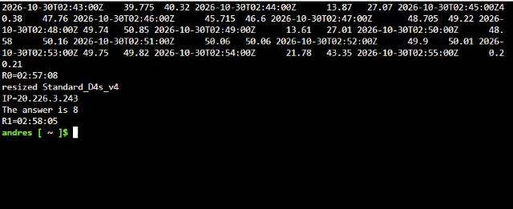

### 9. ¿Qué pasa con la infraestructura al cambiar el tamaño? ¿Efectos negativos?

* La VM se **detiene, se reasigna (puede moverse a otro host físico) y se reinicia** → **downtime** del único nodo, el servicio queda caído.
* Con IP dinámica la IP pública **puede cambiar** (aquí se mantuvo porque la IP Standard es estática).
* Se pierde todo lo que haya en memoria y en el disco temporal.
* El nuevo tamaño puede no estar disponible en ese clúster, zona o región, o puede no haber cuota (como nos pasó con B1ls/B2ms).
* Sigue siendo un **punto único de falla** y hay un **límite físico**: no se puede crecer indefinidamente, y el costo crece más rápido que el beneficio.

### 10. ¿Hubo mejora en el consumo de CPU o en los tiempos de respuesta?

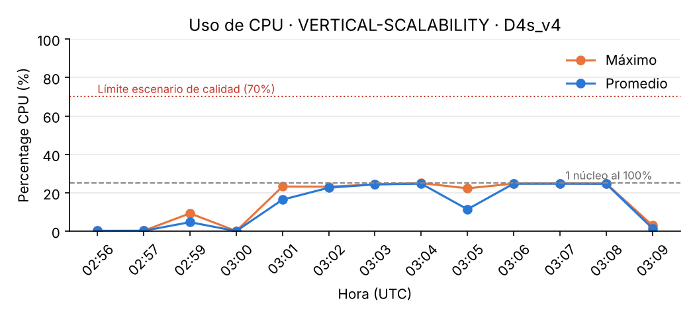

| Métrica | D2s_v4 | D4s_v4 | Cambio |
|---|---|---|---|
| Tiempo promedio (1 petición) | 11,00 s | 9,90 s | −10% |
| Promedio newman x2 | 15,4 s | 14,3 s | −7% |
| Éxito newman x2 | 70% | 70% | igual |
| CPU máxima | ~50% | ~25% | −50% (porcentual) |

**Poca o ninguna mejora real.** El porcentaje de CPU baja a la mitad solo porque hay el doble de núcleos y la app sigue usando uno solo: el trabajo por núcleo es el mismo (100% de un núcleo). Los tiempos mejoran ~10%, no 2×, porque la app no aprovecha los núcleos extra, y la tasa de fallos no cambia porque la causa (el event loop bloqueado) sigue igual.

### 11. Newman con 4 ejecuciones paralelas. ¿El comportamiento es porcentualmente mejor?

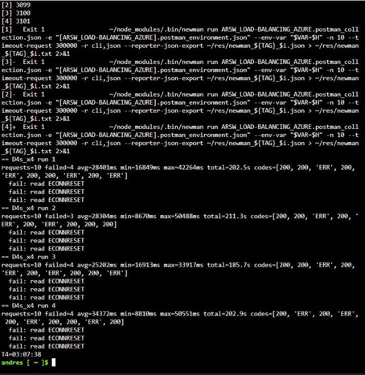

| | D2s_v4 x2 | D2s_v4 x4 | D4s_v4 x2 | D4s_v4 x4 |
|---|---|---|---|---|
| Peticiones | 20 | 40 | 20 | 40 |
| Fallidas | 6 | 12 | 6 | 15 |
| **Éxito** | **70%** | **70%** | **70%** | **62,5%** |
| Tiempo promedio | 15,4 s | 33,3 s | 14,3 s | 29,1 s |
| Duración de la prueba | 137 s | 265 s | 123 s | 211 s |

**No, no es porcentualmente mejor.** Con 4 clientes el tiempo promedio se duplica (~15 s → ~30 s) porque cada petición espera en fila a las de los otros 3 clientes, y la tasa de éxito no mejora (incluso baja a 62,5% en la D4s_v4). La máquina más grande termina la prueba un ~20% antes, pero la proporción de fallos y la espera por cliente siguen igual: escalar verticalmente no ataca el cuello de botella (un único proceso de un solo hilo).

### Paso 12 - Evaluación del escenario de calidad

> *Todas las peticiones deben ser respondidas y la CPU no puede superar el 70%.*

| Condición | D2s_v4 | D4s_v4 |
|---|---|---|
| CPU ≤ 70% | ✅ (~50%) | ✅ (~25%) |
| Todas las peticiones respondidas | ❌ (70% de éxito) | ❌ (62–70% de éxito) |

**El escenario NO se cumple con escalamiento vertical.** La CPU "cumple" solo porque la app no puede usar más de un núcleo, pero entre el 30% y el 38% de las peticiones concurrentes fallaron.

### Paso 13

El grupo de recursos `SCALABILITY_LAB` se eliminó por completo al terminar (en lugar de solo volver al tamaño inicial), para liberar las vCPU que necesitaba la Parte 2 y evitar cobros.

## Parte 2 - Escalabilidad horizontal

> **Nota:** el SKU **Basic** de Load Balancer y de IP pública fue retirado por Azure el 30 de septiembre de 2025, por eso se usó **SKU Standard** en el balanceador y en todas las IPs públicas.

### ¿Tipos de balanceadores en Azure? ¿Qué es SKU? ¿Por qué necesita IP pública?

| Servicio | Capa | Alcance | Uso |
|---|---|---|---|
| **Azure Load Balancer** | 4 (TCP/UDP) | Regional | Distribuir tráfico entre VMs; muy baja latencia |
| **Application Gateway** | 7 (HTTP/S) | Regional | Ruteo por URL/host, terminación TLS, WAF |
| **Front Door** | 7 (HTTP/S) | Global | CDN + balanceo global, WAF, aceleración |
| **Traffic Manager** | DNS | Global | Redirige por DNS (prioridad, geografía, rendimiento) |

Además el Load Balancer puede ser **público** (frontend con IP pública, recibe tráfico de Internet) o **interno** (frontend con IP privada, balancea dentro de la VNet).

**SKU** (Stock Keeping Unit) es la "edición" del recurso, define funcionalidades, límites, SLA y precio:

* **Basic:** gratis, hasta 300 instancias, sin zonas, sin SLA, abierto por defecto. **Retirado (30/09/2025).**
* **Standard:** de pago por reglas y datos procesados, hasta 1000 instancias, soporta **zonas de disponibilidad**, SLA 99,99%, **seguro por defecto** (requiere NSG para dejar pasar tráfico), métricas en Azure Monitor.
* **Gateway:** para encadenar dispositivos virtuales de red (firewalls, NVAs) de terceros.

**IP pública:** es el único punto de entrada que conocen los clientes en Internet; el balanceador recibe en esa IP y reparte a las IPs privadas de las VMs. Sin ella el servicio no sería accesible desde fuera (sería un balanceador interno).

### ¿Propósito del Backend Pool?

Es el **conjunto de instancias (NICs/IPs de las VMs)** que reciben el tráfico. El balanceador solo reparte peticiones entre los miembros del pool; escalar horizontalmente = agregar VMs al pool.

### ¿Propósito del Health Probe?

Verifica periódicamente (cada N segundos, en un puerto/protocolo, ej. TCP 3000 o HTTP `/`) que cada VM del pool responda. Si una falla un número de veces seguidas se **saca de la rotación** y deja de recibir tráfico hasta que vuelva a estar sana. Así se logra **alta disponibilidad** sin enviar peticiones a nodos caídos.

### ¿Propósito de la Load Balancing Rule? ¿Sesión persistente?

Define **cómo se mapea el tráfico**: frontend IP + puerto (80) → backend pool + puerto (3000), protocolo, health probe asociado, timeout y persistencia.

Tipos de **persistencia de sesión (session affinity)**:

* **None (5-tupla, por defecto):** hash de IP origen, puerto origen, IP destino, puerto destino y protocolo. Cada conexión nueva puede ir a cualquier VM.
* **Client IP (2-tupla):** IP origen + IP destino. El mismo cliente siempre va a la misma VM.
* **Client IP and protocol (3-tupla):** IP origen + IP destino + protocolo.

**Importancia:** si la app guarda estado en memoria (sesión, carrito), el cliente debe volver al mismo nodo. **Impacto en escalabilidad:** con persistencia la carga se reparte peor (un cliente muy activo o muchos usuarios tras un mismo NAT saturan un solo nodo), y al agregar o quitar VMs los clientes no se redistribuyen. Lo ideal es una app **stateless** con persistencia en None.

### ¿Qué es una Virtual Network y una Subnet? ¿Address space y address range?

* **VNet:** red privada aislada en Azure donde se comunican los recursos (VMs, LB interno), equivalente a la red de un datacenter propio.
* **Subnet:** segmento de la VNet; permite separar recursos y aplicarles NSGs o rutas distintas.
* **Address space:** el bloque CIDR total de la VNet (ej. `10.0.0.0/16` = 65.536 IPs).
* **Address range:** el sub-bloque asignado a cada subnet dentro del address space (ej. `10.0.0.0/24` = 256 IPs, de las cuales Azure reserva 5). No se pueden solapar entre subnets.

### ¿Qué son las Availability Zones? ¿Por qué 3? ¿IP zone-redundant?

* **Availability Zone:** datacenter(s) físicamente separados dentro de una región, con energía, refrigeración y red independientes.
* Se usan **3 zonas** para que una falla en un datacenter (incendio, corte de energía) solo tumbe 1 de las VMs y el servicio siga respondiendo con las otras 2. SLA de 99,99% para VMs en 2+ zonas.
* **IP zone-redundant:** la IP pública (y el frontend del LB) existe en **todas las zonas a la vez**; si una zona cae la IP sigue respondiendo. Una IP zonal vive en una sola zona.

### ¿Propósito del Network Security Group?

Es un **firewall distribuido de capa 3/4** asociado a subnets o NICs. Con reglas por prioridad (origen, destino, puerto, protocolo, permitir/denegar) controla qué tráfico entra y sale. Aquí permite SSH (22) para administrar y el puerto 3000 para la app; con LB Standard es **obligatorio**, porque sin NSG que lo permita el tráfico es denegado.

### Infraestructura desplegada

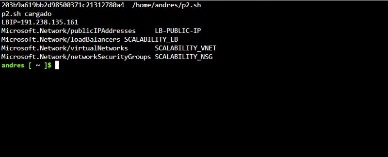

| Recurso | Configuración |
|---|---|
| Resource group | `SCALABILITY_LAB_2` (Brazil South) |
| Load Balancer | `SCALABILITY_LB`, **Standard**, público, frontend `LB-PUBLIC-IP` (zone-redundant, zonas 1-2-3) |
| Backend pool | `SCALABILITY_BACKEND_POOL` con las NIC de VM1, VM2 y VM3 |
| Health probe | `SCALABILITY_HEALTH_PROBE`, TCP puerto 3000, cada 5 s |
| LB rule | `SCALABILITY_LB_RULE`, TCP 80 → 3000, distribución *Default* (5-tupla, sin persistencia), idle timeout 4 min |
| VNet / Subnet | `SCALABILITY_VNET` 10.0.0.0/16 · subnet `default` 10.0.0.0/24 |
| NSG | `SCALABILITY_NSG`: SSH 22 (prioridad 1000) y 3000 (prioridad 1010) |
| VM1 | Zona 1 · `D2s_v4` · IP privada 10.0.0.4 · IP pública propia |
| VM2 | Zona 2 · `D2s_v4` · IP privada 10.0.0.5 · IP pública propia |
| VM3 | Zona 3 · `D2_v4` · IP privada 10.0.0.6 · **sin IP pública** |

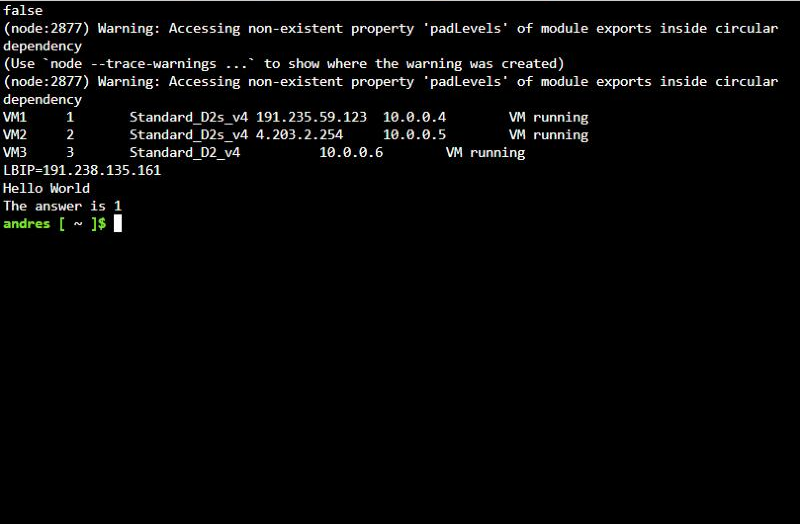

Prueba básica por la IP del balanceador: `http://191.238.135.161/` → `Hello World` y `http://191.238.135.161/fibonacci/1` → `The answer is 1`.

**Problemas encontrados y solución:**

* La suscripción solo permite **3 IPs públicas por región** (`PublicIPCountLimitReached`): una es del balanceador y dos de VM1/VM2, así que la VM3 se creó sin IP pública. No la necesita para servir tráfico, porque le llega por el balanceador a través de la red privada.
* Para que VM3 pudiera descargar Node.js se dejó activo el **SNAT implícito** de la regla de balanceo (sale a Internet por la IP del balanceador). Una *outbound rule* explícita no se pudo usar porque Azure no la permite cuando hay VMs del pool con IP pública propia (`NicWithPublicIpCannotReferencePoolWithOutboundRule`).

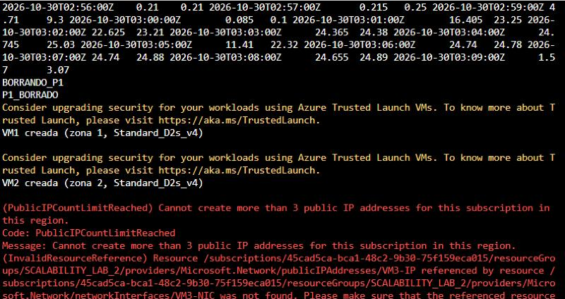

### Punto 2 - Informe comparativo: vertical vs horizontal (newman, 2 ejecuciones paralelas)

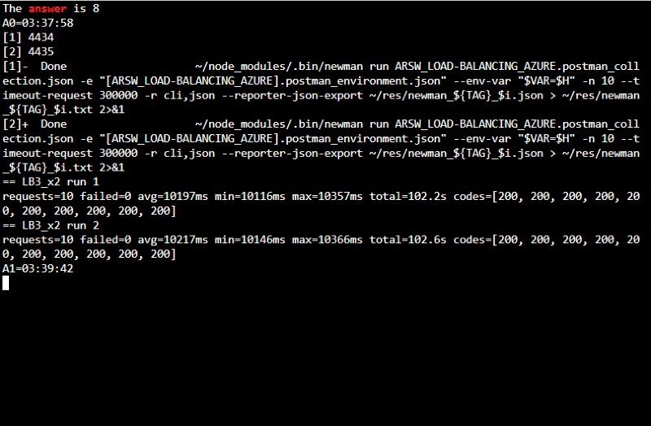

| Métrica | Vertical D2s_v4 | Vertical D4s_v4 | **Horizontal 3 × 2 vCPU + LB** |
|---|---|---|---|
| Peticiones exitosas | 14 / 20 (70%) | 14 / 20 (70%) | **20 / 20 (100%)** |
| Tiempo promedio | 15,4 s | 14,3 s | **10,2 s** |
| Tiempo mínimo / máximo | 10,0 s / 19,7 s | 8,8 s / 18,8 s | **10,1 s / 10,4 s** |
| Duración de la prueba | 137 s | 123 s | **103 s** |
| CPU máxima por nodo | ~50% | ~25% | ~47% (VM1 y VM2) |

**Costos** (precios de lista Linux pago por uso en Brazil South; aproximados, sin discos ni tráfico):

| Infraestructura | Componentes | USD/hora | USD/mes (730 h) |
|---|---|---|---|
| Vertical pequeña | 1 × D2s_v4 + 1 IP | ~0,158 | ~115 |
| Vertical grande | 1 × D4s_v4 + 1 IP | ~0,311 | ~227 |
| Horizontal | 3 × D2(s)_v4 + LB Standard (1 regla) + 3 IP | ~0,499 | ~364 |

La D2s_v4 y la D2_v4 cuestan USD 0,153/h en Brazil South; la D4s_v4 es el doble. Para el LB Standard se tomó ~USD 0,025/h por las primeras 5 reglas y para cada IP pública Standard ~USD 0,005/h.

**Conclusión:** con 2 clientes concurrentes el balanceador reparte cada cliente a un nodo distinto (VM1 y VM2 al ~47% y VM3 libre, ver gráfica de CPU). Cada petición se atiende sin esperar a otra, así que el tiempo baja a lo que tarda una sola petición (~10 s, con muy poca variación) y **no hubo ningún fallo**. La infraestructura horizontal cuesta ~60% más que la vertical grande, pero es la única que cumplió el requerimiento, y además da **alta disponibilidad**: si cae una zona, siguen respondiendo los otros nodos.

### Punto 3 - Cuarta VM y 4 ejecuciones paralelas

**No fue posible crear la 4ª VM:** la suscripción tiene un tope de **6 vCPU por región** y las 3 VMs ya lo ocupan (2 + 2 + 2). Azure rechazó el despliegue:

> *Operation could not be completed as it results in exceeding approved Total Regional Cores quota. Current Limit: 6, Current Usage: 6, Additional Required: 2, (Minimum) New Limit Required: 8*

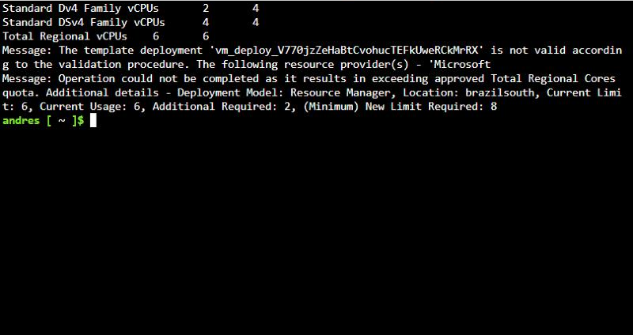

Por eso la prueba con **4 ejecuciones paralelas de newman se hizo contra las 3 VMs**:

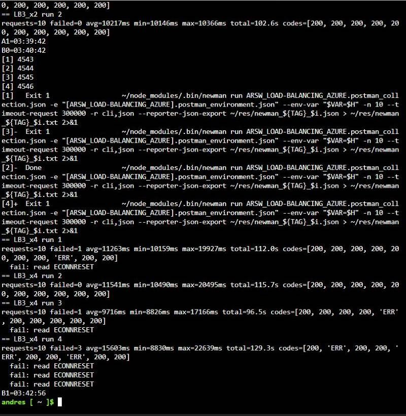

| Ejecución | Peticiones | Fallidas | Promedio | Máx |
|---|---|---|---|---|
| 1 | 10 | 1 | 11,3 s | 19,9 s |
| 2 | 10 | 0 | 11,5 s | 20,5 s |
| 3 | 10 | 1 | 9,7 s | 17,2 s |
| 4 | 10 | 3 | 15,6 s | 22,6 s |
| **Total** | **40** | **5** | **12,0 s** | |

| 4 clientes en paralelo | Vertical D2s_v4 | Vertical D4s_v4 | **Horizontal 3 nodos** |
|---|---|---|---|
| Éxito | 70% (28/40) | 62,5% (25/40) | **87,5% (35/40)** |
| Tiempo promedio | 33,3 s | 29,1 s | **12,0 s** |
| Duración de la prueba | 265 s | 211 s | **129 s** |

**Comportamiento de la CPU de las VMs:**

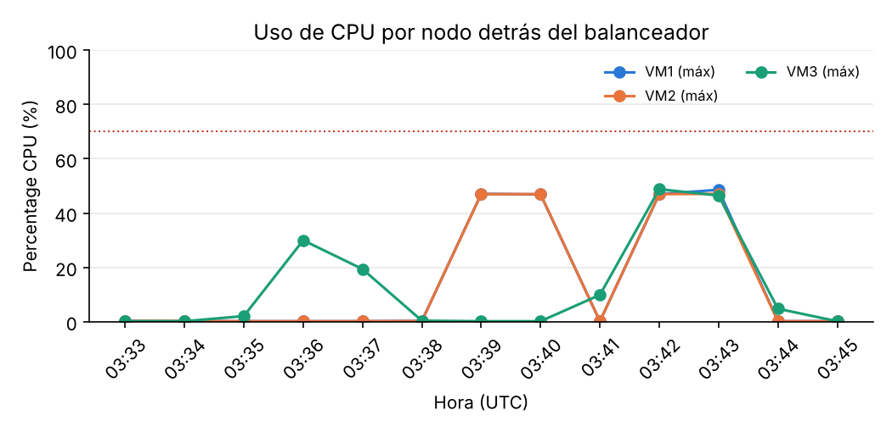

* **03:39-03:40 (newman x2):** solo VM1 y VM2 trabajan (~47%), VM3 en reposo. Cada newman abre **una conexión TCP persistente** y el balanceador (hash de 5-tupla) asigna cada conexión a un nodo; con 2 clientes solo se ocupan 2 nodos.
* **03:42-03:43 (newman x4):** las **tres VMs trabajan a la vez** (~47-49% cada una, es decir, un núcleo completo de cada máquina). Ninguna supera el 70%.
* El pico de VM3 a las 03:36 corresponde a la instalación de Node.js y la app, no a la carga.

**¿Por qué aumentó la tasa de éxito con este estilo de escalabilidad?**

La app es de **un solo hilo**: una VM solo puede calcular un Fibonacci a la vez, sin importar cuántos núcleos tenga. Escalar verticalmente añade núcleos que Node no usa; escalar horizontalmente añade **procesos independientes**, cada uno con su propio hilo y su propio event loop. El balanceador reparte las conexiones entre ellos, así que hay hasta 3 peticiones calculándose en paralelo en lugar de 1. Las peticiones ya no hacen fila, los event loops no quedan bloqueados tanto tiempo y casi no ocurren los `ECONNRESET`.

Los 5 fallos que quedaron con 4 clientes son porque **4 clientes no caben en 3 nodos**: dos clientes comparten una VM y se repite el problema de la Parte 1 en ese nodo (por eso la ejecución 4 concentra 3 fallos). Con la 4ª VM cada cliente tendría su propio nodo y se esperaría el 100% de éxito, igual que en la prueba x2.

### Evaluación del escenario de calidad

| Condición | Vertical | Horizontal (2 clientes) | Horizontal (4 clientes / 3 nodos) |
|---|---|---|---|
| CPU ≤ 70% | ✅ | ✅ (~47%) | ✅ (~49%) |
| Todas las peticiones respondidas | ❌ | ✅ **100%** | ❌ 87,5% (faltó el 4º nodo por cuota) |

El escalamiento horizontal **sí cumple** el escenario cuando hay al menos un nodo por cliente concurrente; el vertical no lo cumple con ningún tamaño.

### Diagrama de despliegue

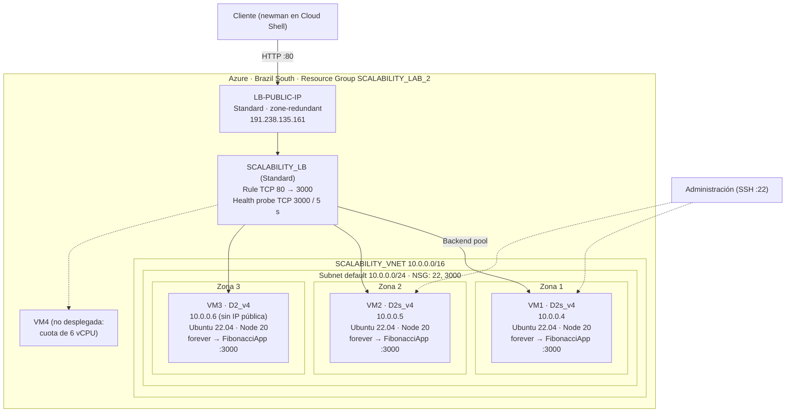

### Limpieza

Al terminar se eliminaron los grupos de recursos `SCALABILITY_LAB` y `SCALABILITY_LAB_2` para no generar más costos.

### Archivos de soporte

* [`scripts/`](scripts/): scripts de Azure CLI para recrear cada parte (`part1-vertical.sh`, `part2-horizontal.sh`) e instalar la app (`setup-app.sh`).
* [`results/`](results/): datos crudos (tiempos, resúmenes de newman, métricas de CPU) y `plots.py`, que genera las gráficas.
* [`images/solution/`](images/solution/): capturas de Cloud Shell y gráficas.
